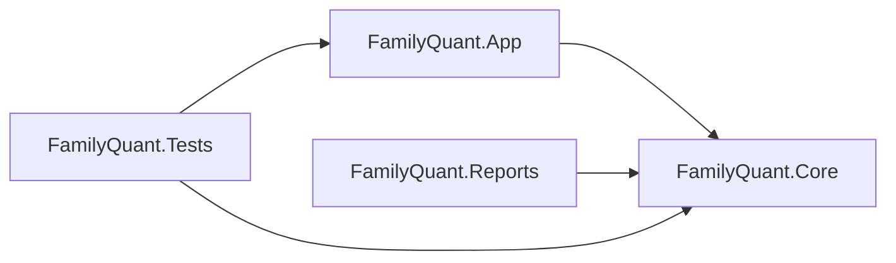

# FamilyQuant 2.0 architecture

This plan keeps the frozen 1.5.0.6 results and the feature ledger as the contracts.
F6 changes assembly boundaries and file locations. Algorithm changes belong to
their named roadmap steps, with their own tests and science gates.

N4 proceeds without waiting for N3 under the orchestrator's M5 assignment. N3 is
owned by FQShell. A feature is not removed by moving its implementation.
The merged [feature ledger](FEATURE-LEDGER.md) records the approved UI retirements;
their shared extraction, partition and homology engines remain available.

## Current projects and planned dependency direction

| Project | Contents | Dependencies |
|---|---|---|
| FamilyQuant.Core | Documents, grouping, evidence, readers, homology, quantitation and headless services | BCL and the existing scientific file/RAW dependencies; no WPF |
| FamilyQuant.App | WPF entry point, views, view models, dialogs, themes and on-screen charts; executable FamilyQuant2 | Core |
| FamilyQuant.Reports (planned, X9) | Separate WPF-capable command-line figure exporter; no project exists yet in this solution | Core and shared drawing source |
| FamilyQuant.Tests | The console suite, numerical fixtures, file-format checks and screen harness | Core and App; never published |

The current solution contains Core, App and Tests. The installed app does not reference the planned Reports project. The Reports target design links the same drawing source
used by App, rather than taking a project reference to the installed executable
or copying a second implementation of a chart. X9 moves the presentation-only
entry points and figures after the Results export flow is ready.

The App project already has the correct name, `FamilyQuant.App.csproj`. F6 keeps
its source directory `FamilyQuant/` stable. This avoids moving every lane's views
and the reserved publish profile while extracting the engine. Core uses
`FamilyQuant.Core/`; Reports uses `FamilyQuant.Reports/` when X9 lands. All existing
C# namespaces stay `FamilyQuant`, `FamilyQuant.DeNovo` and `FamilyQuant.Homology`.
The frozen `ReferenceGoldenHost` remains an auxiliary test executable referencing
only the read-only 1.5 binaries. It does not join the installed application's graph.

## F6 boundary and behavior preservation

Move WPF-free implementation files and the embedded USEARCH resource into Core.
Keep WPF files, themes and entry-point metadata in App. Keep presentation wrappers
that depend on drawing types in App until X9, even if a wrapper has no WPF using.

`AppVersionInfo` stays in App: its assembly lookup must report the executable's
version, not Core's version. `MyResources.resx` and its designer move together;
Core's root namespace remains `FamilyQuant`, retaining the resource name
`FamilyQuant.MyResources.resources`. USEARCH extraction still uses FamilyQuant2's
local data folder. Runtime switches needed by SEPro remain on App and Tests.

F6 does not change a scientific formula, traversal order, threshold, serializer
field, cache key, or user choice. Read each moved file and compare its bytes before
and after the move. Record any necessary boundary-only edit separately. The
existing vendor DLLs remain in `FamilyQuant/DLLs`; Core uses relative references
to that one copy. Keep their versions and the resolved RAW dependencies unchanged.
Keep `Properties/PublishProfiles`, images, DLLs and executable assembly metadata in
their existing App paths. F6 does not edit a publish profile or a version field.

App and Tests retain direct vendor references where they use vendor types:
HintPath references do not flow through project references. Core must not acquire
Extended.Wpf.Toolkit or a WindowsDesktop/WPF framework reference. Its Windows
target is for the existing RAW/file integrations, not for a UI dependency.

F6 marks Core's checked-in vendor references `ExternallyResolved`, with scientific
dependencies named explicitly. App resolves their complete runtime graph. This
keeps the unused WindowsBase metadata in PatternTools out of Core's compiler
graph without a warning suppression or a WPF framework reference. See the
[MSBuild resolution contract](https://learn.microsoft.com/en-us/dotnet/api/microsoft.build.tasks.resolveassemblyreference?view=msbuild-18-netcore).
The Core DLL reference check passes; real RAW behavior remains part of the full
merge gate. The shared `SpreadsheetSafeCsv` class becomes public so the existing
App report writer can call it; its implementation is unchanged.

XAML that names a moved type uses an explicit Core assembly namespace. Resource
tests follow the resource's owning assembly. The executable's identity, title and
deployment-version tests continue to use App. Avoid widening internal APIs just
to make the move compile; inspect each cross-assembly use first.

Acceptance is a clean build, unchanged quick/full check counts on the same head,
the golden comparison, a Core reference check, and a publish payload containing
Core. The orchestrator owns the full real-data and golden merge gates. A build or
the quick suite alone does not establish numerical parity on the stored project.

Recorded F6 builder verification (historical counts, not the current suite total): 71 moved files, of which 69 remain byte-identical. The
other two have only the documented CSV class visibility and resource path edits.
Core and solution builds have zero warnings/errors; the focused boundary check
passes 4/4, after failing 3/4 before extraction. The quick suite passes 1727 checks
with zero failures and 17 skips, including E1 and the four new boundary checks.
The local publish payload contains Core and every prior DLL; required scientific
vendor DLLs have unchanged hashes, and no Tests or Reports payload is present.
The builder has not run the full real-data/golden gate or installed either app.

## Views and view models

X2 separates the 702-line family file into a 198-line document, a 343-line
per-document PatternLab attribution service and a 206-line scoring/search service.
Public document entry points remain compatible. Calculation bodies, traversal and
I/O are preserved; only the unused normalized-cache slot is removed. Legacy XIC
still deserializes and is omitted from new writes through .NET 10's serialization
condition. Current XICUser, identifiers, sequence and curation migration persist.
Verification: focused file/scoring/denominator fixtures 64/64; quick suite
1802 passed, zero failed, 18 skipped. Two stored-project golden exports each pass
all four byte comparisons to frozen 1.5.0.6, and their four files match each other.
That recorded skip concerned the then-pending shell curation-status integration seam; the seam has since landed.

Use ordinary `INotifyPropertyChanged` view models and small command classes in
App; do not add an MVVM framework. A view model exposes the selected document,
parameters, current selection, enabled reasons, status and command state. It
calls a tested Core service and applies a completed result to the same document
instance it started with. Core never sees a control, Dispatcher or MessageBox.

Code-behind handles view-only work: focus, dialogs, clipboard, drag/drop and visual
lifetime. Commands own re-entry protection and cancellation. S6 still owns the planned single operation
host for shell busy state, progress and Cancel; the merged Core context alone does not supply that UI. Completion checks
the captured document/quant/manifest identity before attaching results; keep the
existing Save and Full XIC stale-result protections.

These are implementation budgets for the rebuild, not permission to omit a
feature. When a view model exceeds its budget, split an operation or presentation
model into a named tested component rather than hiding logic in code-behind.

| View | XAML lines | Code-behind lines | View-model lines | Owning step |
|---|---:|---:|---:|---|
| Main shell and navigation | 180 | 120 | 350 | S2 |
| Start page | 120 | 60 | 180 | S4 |
| Curation and family details | 300 | 120 | 400 | C1, C2, C5 |
| Build families and identity search | 220 | 100 | 350 | C6, C7 |
| Quantify | 220 | 100 | 350 | C8 |
| Results | 240 | 100 | 350 | C9 |
| De novo | 300 | 120 | 400 | C10 |
| Evidence/keyword review | 300 | 120 | 400 | C4 |
| Each secondary window | 180 | 80 | 250 | C12 |

The existing code-only secondary windows may remain code-only thin views. Their
presentation models and commands still receive the same tests as XAML views.

## Shared drawing base

X8 puts axes, ticks, label measurement, clipping, empty states and PNG export on
one WPF drawing path. Keep chart-specific scientific reductions in Core and
chart-specific geometry in the concrete chart. The base accepts data and palette;
it does not infer a denominator or change a reported fraction.

`ChartPalette` remains the single chart palette. App selects its screen variant;
Reports and existing PNG exports explicitly use the pinned Light palette. Share
the drawing source with Reports through compile links so fixes have one owner.
X8 must retain image dimensions, numeric labels and the existing PNG checks. The
deck and its assets remain untouched.

## Errors, progress and cancellation

X10 defines a Core operation-progress value with stage, completed/total work and
a user-readable message, delivered through `IProgress<T>`. Long operations accept
`CancellationToken`; they do not consult App state. Preserve existing callbacks
until their owning rewrite moves each operation to this common contract.

An input refusal names the input and the reason. Operational failures retain the
original exception context for diagnostics. App turns these into its status and
detail view. Cancellation is a distinct completion state, not a zero-valued
scientific result. Core contains no MessageBox or window creation.

Prepare results before changing the document. A refused batch, failed save check
or cancellation leaves the prior document usable. Fetch stays all-or-nothing,
curation stays one undo step, and a canceled computation never replaces stored
quantitation with an empty result. Temporary output is separate from inputs;
successful persistent caches retain their current keys and provenance.

## File inventory

The following table is the recorded planning/destination snapshot, including generated source,
XAML, resource files and project files. Its original source paths can intentionally differ from current paths after F6. It gives the first destination and the
later rewrite owner for each file. Copy means preserve implementation and behavior;
it does not mean that later work has been completed or reviewed.

<!-- SOURCE-INVENTORY -->

Recorded X3 planning inventory: 223 files/rows. These destination paths remain valid, but later additions are not claimed to be in this snapshot. For the current tracked set run `git ls-files -- "FamilyQuant/*.cs" "FamilyQuant/*.xaml" "FamilyQuant/*.resx" "FamilyQuant/*.csproj" "FamilyQuant.Core/*.cs" "FamilyQuant.Core/*.resx" "FamilyQuant.Core/*.csproj" "FamilyQuant.Tests/*.cs" "FamilyQuant.Tests/*.csproj"`. The document/command catalog is [INDEX.md](INDEX.md).

| Source path at planning | Destination | Copy/rewrite plan |
|---|---|---|
| `FamilyQuant.Core/ClusteringResults.cs` | `FamilyQuant.Core/ClusteringResults.cs` | X3: clear clustering/redundancy results; keep numerical algorithms |
| `FamilyQuant.Core/DescriptionWordMatcher.cs` | `FamilyQuant.Core/DescriptionWordMatcher.cs` | X3: clear clustering/redundancy results; keep numerical algorithms |
| `FamilyQuant.Core/Evidence/EvidenceClassifier.cs` | `FamilyQuant.Core/Evidence/EvidenceClassifier.cs` | Keep published evidence implementation in Core; owned by its assigned EV/Opus step |
| `FamilyQuant.Core/Evidence/EvidenceFetcher.cs` | `FamilyQuant.Core/Evidence/EvidenceFetcher.cs` | Keep published evidence implementation in Core; owned by its assigned EV/Opus step |
| `FamilyQuant.Core/Evidence/EvidenceProposal.cs` | `FamilyQuant.Core/Evidence/EvidenceProposal.cs` | Keep published evidence implementation in Core; owned by its assigned EV/Opus step |
| `FamilyQuant.Core/Evidence/FamilyMembership.cs` | `FamilyQuant.Core/Evidence/FamilyMembership.cs` | Keep published evidence implementation in Core; owned by its assigned EV/Opus step |
| `FamilyQuant.Core/Evidence/FetchProvenance.cs` | `FamilyQuant.Core/Evidence/FetchProvenance.cs` | Keep published evidence implementation in Core; owned by its assigned EV/Opus step |
| `FamilyQuant.Core/Evidence/NearestReviewed.cs` | `FamilyQuant.Core/Evidence/NearestReviewed.cs` | Keep published evidence implementation in Core; owned by its assigned EV/Opus step |
| `FamilyQuant.Core/Evidence/ReferencePanel.cs` | `FamilyQuant.Core/Evidence/ReferencePanel.cs` | Keep published evidence implementation in Core; owned by its assigned EV/Opus step |
| `FamilyQuant.Core/FamilyClusterScoring.cs` | `FamilyQuant.Core/FamilyClusterScoring.cs` | X2: target/decoy score and identity-search implementation extracted unchanged |
| `FamilyQuant.Core/FamilyQuant.Core.csproj` | `FamilyQuant.Core/FamilyQuant.Core.csproj` | New F6 library project; no WPF, existing package pins and explicit vendor references |
| `FamilyQuant.Core/Operations/CoreOperation.cs` | `FamilyQuant.Core/Operations/CoreOperation.cs` | X10: shared WPF-free operation outcome, progress, cancellation and final-commit contract |
| `FamilyQuant.Core/PatternLabAttribution.cs` | `FamilyQuant.Core/PatternLabAttribution.cs` | X2: per-document PLP caches and attribution implementation extracted unchanged |
| `FamilyQuant.Core/ShellProjectOperations.cs` | `FamilyQuant.Core/ShellProjectOperations.cs` | Keep headless shell document services; X10 optional context for project reads |
| `FamilyQuant.Tests/AttributionRuleStudy.cs` | `FamilyQuant.Tests/AttributionRuleStudy.cs` | Keep test coverage; update only API/path integration when its owning step moves code |
| `FamilyQuant.Tests/ChargeAudit.cs` | `FamilyQuant.Tests/ChargeAudit.cs` | Keep test coverage; update only API/path integration when its owning step moves code |
| `FamilyQuant.Tests/ChartExportSnapshot.cs` | `FamilyQuant.Tests/ChartExportSnapshot.cs` | Keep program-produced parity and regression checks with the owning step |
| `FamilyQuant.Tests/ClusteringSnapshot.cs` | `FamilyQuant.Tests/ClusteringSnapshot.cs` | Keep program-produced parity and regression checks with the owning step |
| `FamilyQuant.Tests/DeNovoXicTests.cs` | `FamilyQuant.Tests/DeNovoXicTests.cs` | Keep test coverage; update only API/path integration when its owning step moves code |
| `FamilyQuant.Tests/EvidenceClassifierCheck.cs` | `FamilyQuant.Tests/EvidenceClassifierCheck.cs` | Keep program-produced parity and regression checks with the owning step |
| `FamilyQuant.Tests/EvidenceFetchCheck.cs` | `FamilyQuant.Tests/EvidenceFetchCheck.cs` | Keep evidence/operation regression coverage with its owning step |
| `FamilyQuant.Tests/EvidenceRuleGuard.cs` | `FamilyQuant.Tests/EvidenceRuleGuard.cs` | Keep program-produced parity and regression checks with the owning step |
| `FamilyQuant.Tests/EvidenceStorageCheck.cs` | `FamilyQuant.Tests/EvidenceStorageCheck.cs` | Keep E1 storage/size checks; use the published evidence contract |
| `FamilyQuant.Tests/FamilyQuant.Tests.csproj` | `FamilyQuant.Tests/FamilyQuant.Tests.csproj` | Keep test coverage; update only API/path integration when its owning step moves code |
| `FamilyQuant.Tests/FeatureLedger.cs` | `FamilyQuant.Tests/FeatureLedger.cs` | Keep test coverage; update only API/path integration when its owning step moves code |
| `FamilyQuant.Tests/GoldenNumbers.cs` | `FamilyQuant.Tests/GoldenNumbers.cs` | Keep test coverage; update only API/path integration when its owning step moves code |
| `FamilyQuant.Tests/HomologyTests.cs` | `FamilyQuant.Tests/HomologyTests.cs` | Keep test coverage; update only API/path integration when its owning step moves code |
| `FamilyQuant.Tests/IsotopePrecursorEquivalenceTests.cs` | `FamilyQuant.Tests/IsotopePrecursorEquivalenceTests.cs` | Keep test coverage; update only API/path integration when its owning step moves code |
| `FamilyQuant.Tests/LogoAssets.cs` | `FamilyQuant.Tests/LogoAssets.cs` | Keep program-produced parity and regression checks with the owning step |
| `FamilyQuant.Tests/NearestReviewedCheck.cs` | `FamilyQuant.Tests/NearestReviewedCheck.cs` | Keep operation and shell navigation regression coverage |
| `FamilyQuant.Tests/Program.Analytics.cs` | `FamilyQuant.Tests/Program.Analytics.cs` | Keep test coverage; update only API/path integration when its owning step moves code |
| `FamilyQuant.Tests/Program.AppShell.cs` | `FamilyQuant.Tests/Program.AppShell.cs` | Keep test coverage; update only API/path integration when its owning step moves code |
| `FamilyQuant.Tests/Program.Charts.cs` | `FamilyQuant.Tests/Program.Charts.cs` | Keep test coverage; update only API/path integration when its owning step moves code |
| `FamilyQuant.Tests/Program.ClusteringResults.cs` | `FamilyQuant.Tests/Program.ClusteringResults.cs` | Keep program-produced parity and regression checks with the owning step |
| `FamilyQuant.Tests/Program.CoreOperations.cs` | `FamilyQuant.Tests/Program.CoreOperations.cs` | Keep evidence/operation regression coverage with its owning step |
| `FamilyQuant.Tests/Program.Csv.cs` | `FamilyQuant.Tests/Program.Csv.cs` | Keep test coverage; update only API/path integration when its owning step moves code |
| `FamilyQuant.Tests/Program.Curation.cs` | `FamilyQuant.Tests/Program.Curation.cs` | Keep test coverage; update only API/path integration when its owning step moves code |
| `FamilyQuant.Tests/Program.CurationStorage.cs` | `FamilyQuant.Tests/Program.CurationStorage.cs` | Keep test coverage; update only API/path integration when its owning step moves code |
| `FamilyQuant.Tests/Program.Database.cs` | `FamilyQuant.Tests/Program.Database.cs` | Keep test coverage; update only API/path integration when its owning step moves code |
| `FamilyQuant.Tests/Program.DeNovo.cs` | `FamilyQuant.Tests/Program.DeNovo.cs` | Keep test coverage; update only API/path integration when its owning step moves code |
| `FamilyQuant.Tests/Program.DeNovoRealData.cs` | `FamilyQuant.Tests/Program.DeNovoRealData.cs` | Keep test coverage; update only API/path integration when its owning step moves code |
| `FamilyQuant.Tests/Program.DeNovoScreen.cs` | `FamilyQuant.Tests/Program.DeNovoScreen.cs` | Keep test coverage; update only API/path integration when its owning step moves code |
| `FamilyQuant.Tests/Program.DeadPaths.cs` | `FamilyQuant.Tests/Program.DeadPaths.cs` | Keep test coverage; update only API/path integration when its owning step moves code |
| `FamilyQuant.Tests/Program.FamilyComposition.cs` | `FamilyQuant.Tests/Program.FamilyComposition.cs` | Keep test coverage; update only API/path integration when its owning step moves code |
| `FamilyQuant.Tests/Program.FeatureLedger.cs` | `FamilyQuant.Tests/Program.FeatureLedger.cs` | Keep test coverage; update only API/path integration when its owning step moves code |
| `FamilyQuant.Tests/Program.Filtering.cs` | `FamilyQuant.Tests/Program.Filtering.cs` | Keep test coverage; update only API/path integration when its owning step moves code |
| `FamilyQuant.Tests/Program.FullXic.cs` | `FamilyQuant.Tests/Program.FullXic.cs` | Keep test coverage; update only API/path integration when its owning step moves code |
| `FamilyQuant.Tests/Program.GridCopy.cs` | `FamilyQuant.Tests/Program.GridCopy.cs` | Keep test coverage; update only API/path integration when its owning step moves code |
| `FamilyQuant.Tests/Program.GroupingScore.cs` | `FamilyQuant.Tests/Program.GroupingScore.cs` | Keep test coverage; update only API/path integration when its owning step moves code |
| `FamilyQuant.Tests/Program.HomeStart.cs` | `FamilyQuant.Tests/Program.HomeStart.cs` | Keep shell/curation regression coverage with its owning screen step |
| `FamilyQuant.Tests/Program.HomologyRealData.cs` | `FamilyQuant.Tests/Program.HomologyRealData.cs` | Keep test coverage; update only API/path integration when its owning step moves code |
| `FamilyQuant.Tests/Program.IdentityScan.cs` | `FamilyQuant.Tests/Program.IdentityScan.cs` | Keep test coverage; update only API/path integration when its owning step moves code |
| `FamilyQuant.Tests/Program.Ms1Envelope.cs` | `FamilyQuant.Tests/Program.Ms1Envelope.cs` | Keep test coverage; update only API/path integration when its owning step moves code |
| `FamilyQuant.Tests/Program.NativeFractions.cs` | `FamilyQuant.Tests/Program.NativeFractions.cs` | Keep test coverage; update only API/path integration when its owning step moves code |
| `FamilyQuant.Tests/Program.NearestReviewed.cs` | `FamilyQuant.Tests/Program.NearestReviewed.cs` | Keep evidence/operation regression coverage with its owning step |
| `FamilyQuant.Tests/Program.OperationCancellation.cs` | `FamilyQuant.Tests/Program.OperationCancellation.cs` | Keep operation and shell navigation regression coverage |
| `FamilyQuant.Tests/Program.ProjectStore.cs` | `FamilyQuant.Tests/Program.ProjectStore.cs` | Keep test coverage; update only API/path integration when its owning step moves code |
| `FamilyQuant.Tests/Program.ProteinDomains.cs` | `FamilyQuant.Tests/Program.ProteinDomains.cs` | Keep test coverage; update only API/path integration when its owning step moves code |
| `FamilyQuant.Tests/Program.QuantifyViewModel.cs` | `FamilyQuant.Tests/Program.QuantifyViewModel.cs` | Keep program-produced parity and regression checks with the owning step |
| `FamilyQuant.Tests/Program.Quantitation.cs` | `FamilyQuant.Tests/Program.Quantitation.cs` | Keep test coverage; update only API/path integration when its owning step moves code |
| `FamilyQuant.Tests/Program.ReferencePanel.cs` | `FamilyQuant.Tests/Program.ReferencePanel.cs` | Keep program-produced parity and regression checks with the owning step |
| `FamilyQuant.Tests/Program.ReportsAndHelp.cs` | `FamilyQuant.Tests/Program.ReportsAndHelp.cs` | Keep test coverage; update only API/path integration when its owning step moves code |
| `FamilyQuant.Tests/Program.ResultsViewModel.cs` | `FamilyQuant.Tests/Program.ResultsViewModel.cs` | Keep program-produced parity and regression checks with the owning step |
| `FamilyQuant.Tests/Program.ShellNavigation.cs` | `FamilyQuant.Tests/Program.ShellNavigation.cs` | Keep operation and shell navigation regression coverage |
| `FamilyQuant.Tests/Program.ShellSaving.cs` | `FamilyQuant.Tests/Program.ShellSaving.cs` | Keep program-produced parity and regression checks with the owning step |
| `FamilyQuant.Tests/Program.ShellStatus.cs` | `FamilyQuant.Tests/Program.ShellStatus.cs` | Keep shell/curation regression coverage with its owning screen step |
| `FamilyQuant.Tests/Program.ShellWindowPreferences.cs` | `FamilyQuant.Tests/Program.ShellWindowPreferences.cs` | Keep program-produced parity and regression checks with the owning step |
| `FamilyQuant.Tests/Program.SourceContracts.cs` | `FamilyQuant.Tests/Program.SourceContracts.cs` | Keep test coverage; update only API/path integration when its owning step moves code |
| `FamilyQuant.Tests/Program.StandardMenu.cs` | `FamilyQuant.Tests/Program.StandardMenu.cs` | Keep shell/curation regression coverage with its owning screen step |
| `FamilyQuant.Tests/Program.SuperClusterPreview.cs` | `FamilyQuant.Tests/Program.SuperClusterPreview.cs` | Keep test coverage; update only API/path integration when its owning step moves code |
| `FamilyQuant.Tests/Program.ThreeWayPartition.cs` | `FamilyQuant.Tests/Program.ThreeWayPartition.cs` | Keep test coverage; update only API/path integration when its owning step moves code |
| `FamilyQuant.Tests/Program.UiLayout.cs` | `FamilyQuant.Tests/Program.UiLayout.cs` | Keep test coverage; update only API/path integration when its owning step moves code |
| `FamilyQuant.Tests/Program.WordClustering.cs` | `FamilyQuant.Tests/Program.WordClustering.cs` | Keep test coverage; update only API/path integration when its owning step moves code |
| `FamilyQuant.Tests/Program.XicExtraction.cs` | `FamilyQuant.Tests/Program.XicExtraction.cs` | Keep test coverage; update only API/path integration when its owning step moves code |
| `FamilyQuant.Tests/Program.cs` | `FamilyQuant.Tests/Program.cs` | Keep test coverage; update only API/path integration when its owning step moves code |
| `FamilyQuant.Tests/RawScanAudit.cs` | `FamilyQuant.Tests/RawScanAudit.cs` | Keep test coverage; update only API/path integration when its owning step moves code |
| `FamilyQuant.Tests/ReferenceGoldenHost/Program.cs` | `FamilyQuant.Tests/ReferenceGoldenHost/Program.cs` | Keep frozen-reference host isolated; never substitute current App/Core binaries |
| `FamilyQuant.Tests/ReferenceGoldenHost/ReferenceGoldenHost.csproj` | `FamilyQuant.Tests/ReferenceGoldenHost/ReferenceGoldenHost.csproj` | Keep frozen-reference host isolated; never substitute current App/Core binaries |
| `FamilyQuant.Tests/ScreenHarness.cs` | `FamilyQuant.Tests/ScreenHarness.cs` | Keep test coverage; update only API/path integration when its owning step moves code |
| `FamilyQuant.Tests/ShortPsmPeaksTable.cs` | `FamilyQuant.Tests/ShortPsmPeaksTable.cs` | Keep test coverage; update only API/path integration when its owning step moves code |
| `FamilyQuant.Tests/SourceAwareDeNovoTests.cs` | `FamilyQuant.Tests/SourceAwareDeNovoTests.cs` | Keep test coverage; update only API/path integration when its owning step moves code |
| `FamilyQuant.Tests/TalkFigures.cs` | `FamilyQuant.Tests/TalkFigures.cs` | Keep test coverage; update only API/path integration when its owning step moves code |
| `FamilyQuant.Tests/ThreeWayAudit.cs` | `FamilyQuant.Tests/ThreeWayAudit.cs` | Keep test coverage; update only API/path integration when its owning step moves code |
| `FamilyQuant.Tests/WordGroupingSnapshot.cs` | `FamilyQuant.Tests/WordGroupingSnapshot.cs` | Keep program-produced parity and regression checks with the owning step |
| `FamilyQuant/AnalyticsControl.xaml` | `FamilyQuant/AnalyticsControl.xaml` | Copy in F6; C9: results view (FQEvidence) |
| `FamilyQuant/AnalyticsControl.xaml.cs` | `FamilyQuant/AnalyticsControl.xaml.cs` | Copy in F6; C9: results view (FQEvidence) |
| `FamilyQuant/AnalyticsFigures.cs` | `FamilyQuant/AnalyticsFigures.cs` | Copy in F6; Keep UI resources; theme work stays with FQLook |
| `FamilyQuant/AnalyticsModel.cs` | `FamilyQuant.Core/AnalyticsModel.cs` | Copy to Core in F6; Keep the existing tested implementation |
| `FamilyQuant/AnalyticsViewModel.cs` | `FamilyQuant/AnalyticsViewModel.cs` | Keep App presentation and shell integration with its assigned LK/SH/RS step |
| `FamilyQuant/App.xaml` | `FamilyQuant/App.xaml` | Copy in F6; Keep UI resources; theme work stays with FQLook |
| `FamilyQuant/App.xaml.cs` | `FamilyQuant/App.xaml.cs` | Copy in F6; Keep UI resources; theme work stays with FQLook |
| `FamilyQuant/AppVersionInfo.cs` | `FamilyQuant/AppVersionInfo.cs` | Keep in App: version comes from the executable/deployment assembly |
| `FamilyQuant/ApplicationPaths.cs` | `FamilyQuant.Core/ApplicationPaths.cs` | Copy to Core in F6; X10: retain isolated program-owned output paths |
| `FamilyQuant/AssemblyInfo.cs` | `FamilyQuant/AssemblyInfo.cs` | Copy in F6; Keep UI resources; theme work stays with FQLook |
| `FamilyQuant/BatchCuration.cs` | `FamilyQuant.Core/BatchCuration.cs` | Copy to Core in F6; Keep the existing tested implementation |
| `FamilyQuant/ChartDrawingBase.cs` | `FamilyQuant/ChartDrawingBase.cs` | Keep App presentation and shell integration with its assigned LK/SH/RS step |
| `FamilyQuant/ChartImageExporter.cs` | `FamilyQuant/ChartImageExporter.cs` | Copy in F6; X8: share drawing base and preserve exported PNGs |
| `FamilyQuant/ChartPalette.cs` | `FamilyQuant/ChartPalette.cs` | Copy in F6; X8: share drawing base and preserve exported PNGs |
| `FamilyQuant/ClusterGenerationControl.xaml` | `FamilyQuant/ClusterGenerationControl.xaml` | Copy in F6; C1/C2/C5: thin curation views and tested view models |
| `FamilyQuant/ClusterGenerationControl.xaml.cs` | `FamilyQuant/ClusterGenerationControl.xaml.cs` | Copy in F6; C1/C2/C5: thin curation views and tested view models |
| `FamilyQuant/ComputeXicViewModel.cs` | `FamilyQuant/ComputeXicViewModel.cs` | Keep App presentation and shell integration with its assigned LK/SH/RS step |
| `FamilyQuant/ComputeXicWindow.xaml` | `FamilyQuant/ComputeXicWindow.xaml` | Copy in F6; C8: quantify view (FQEvidence) |
| `FamilyQuant/ComputeXicWindow.xaml.cs` | `FamilyQuant/ComputeXicWindow.xaml.cs` | Copy in F6; C8: quantify view (FQEvidence) |
| `FamilyQuant/CsvReport.cs` | `FamilyQuant.Core/CsvReport.cs` | Copy to Core in F6; Keep the existing tested implementation |
| `FamilyQuant/DeNovo/DeNovoAcceptedScoreScatterStudy.cs` | `FamilyQuant.Core/DeNovo/DeNovoAcceptedScoreScatterStudy.cs` | Copy to Core in F6; Keep scientific reduction and existing tests |
| `FamilyQuant/DeNovo/DeNovoAgreementStudy.cs` | `FamilyQuant.Core/DeNovo/DeNovoAgreementStudy.cs` | Copy to Core in F6; Keep scientific reduction and existing tests |
| `FamilyQuant/DeNovo/DeNovoBatchExtractor.cs` | `FamilyQuant.Core/DeNovo/DeNovoBatchExtractor.cs` | Copy to Core in F6; X6: organize readers/reconciliation, retaining pinned behavior |
| `FamilyQuant/DeNovo/DeNovoFilter.cs` | `FamilyQuant.Core/DeNovo/DeNovoFilter.cs` | Copy to Core in F6; X6: organize readers/reconciliation, retaining pinned behavior |
| `FamilyQuant/DeNovo/DeNovoIdentificationSummary.cs` | `FamilyQuant.Core/DeNovo/DeNovoIdentificationSummary.cs` | Copy to Core in F6; X6: organize readers/reconciliation, retaining pinned behavior |
| `FamilyQuant/DeNovo/DeNovoOverlapStudy.cs` | `FamilyQuant.Core/DeNovo/DeNovoOverlapStudy.cs` | Copy to Core in F6; Keep scientific reduction and existing tests |
| `FamilyQuant/DeNovo/DeNovoReconciler.cs` | `FamilyQuant.Core/DeNovo/DeNovoReconciler.cs` | Copy to Core in F6; X6: organize readers/reconciliation, retaining pinned behavior |
| `FamilyQuant/DeNovo/DeNovoReconciliationReport.cs` | `FamilyQuant.Core/DeNovo/DeNovoReconciliationReport.cs` | Copy to Core in F6; X6: organize readers/reconciliation, retaining pinned behavior |
| `FamilyQuant/DeNovo/DeNovoScoreDistribution.cs` | `FamilyQuant.Core/DeNovo/DeNovoScoreDistribution.cs` | Copy to Core in F6; X6: organize readers/reconciliation, retaining pinned behavior |
| `FamilyQuant/DeNovo/DeNovoScoreScatterStudy.cs` | `FamilyQuant.Core/DeNovo/DeNovoScoreScatterStudy.cs` | Copy to Core in F6; Keep scientific reduction and existing tests |
| `FamilyQuant/DeNovo/DeNovoSource.cs` | `FamilyQuant.Core/DeNovo/DeNovoSource.cs` | Copy to Core in F6; X6: organize readers/reconciliation, retaining pinned behavior |
| `FamilyQuant/DeNovo/DeNovoSourceVennStudy.cs` | `FamilyQuant.Core/DeNovo/DeNovoSourceVennStudy.cs` | Copy to Core in F6; Keep scientific reduction and existing tests |
| `FamilyQuant/DeNovo/DeNovoTalkComparison.cs` | `FamilyQuant.Core/DeNovo/DeNovoTalkComparison.cs` | Copy to Core in F6; Keep scientific reduction and existing tests |
| `FamilyQuant/DeNovo/DeNovoUnionResolver.cs` | `FamilyQuant.Core/DeNovo/DeNovoUnionResolver.cs` | Copy to Core in F6; X6: organize readers/reconciliation, retaining pinned behavior |
| `FamilyQuant/DeNovo/DeNovoVariantComparison.cs` | `FamilyQuant.Core/DeNovo/DeNovoVariantComparison.cs` | Copy to Core in F6; Keep scientific reduction and existing tests |
| `FamilyQuant/DeNovo/DeNovoXicCache.cs` | `FamilyQuant.Core/DeNovo/DeNovoXicCache.cs` | Copy to Core in F6; X6: organize readers/reconciliation, retaining pinned behavior |
| `FamilyQuant/DeNovo/DeNovoXicExtractor.cs` | `FamilyQuant.Core/DeNovo/DeNovoXicExtractor.cs` | Copy to Core in F6; X6: organize readers/reconciliation, retaining pinned behavior |
| `FamilyQuant/DeNovo/IdentificationConcordanceStudy.cs` | `FamilyQuant.Core/DeNovo/IdentificationConcordanceStudy.cs` | Copy to Core in F6; Keep scientific reduction and existing tests |
| `FamilyQuant/DeNovo/IdentifiedQuantExtractor.cs` | `FamilyQuant.Core/DeNovo/IdentifiedQuantExtractor.cs` | Copy to Core in F6; X6: organize readers/reconciliation, retaining pinned behavior |
| `FamilyQuant/DeNovo/Ms1EnvelopeDetector.cs` | `FamilyQuant.Core/DeNovo/Ms1EnvelopeDetector.cs` | Copy to Core in F6; X6: organize readers/reconciliation, retaining pinned behavior |
| `FamilyQuant/DeNovo/NativeQuantFractions.cs` | `FamilyQuant.Core/DeNovo/NativeQuantFractions.cs` | Copy to Core in F6; X6: organize readers/reconciliation, retaining pinned behavior |
| `FamilyQuant/DeNovo/PatternLabRunQuants.cs` | `FamilyQuant.Core/DeNovo/PatternLabRunQuants.cs` | Copy to Core in F6; X6: organize readers/reconciliation, retaining pinned behavior |
| `FamilyQuant/DeNovo/PeaksDatabasePsmReader.cs` | `FamilyQuant.Core/DeNovo/PeaksDatabasePsmReader.cs` | Copy to Core in F6; X6: organize readers/reconciliation, retaining pinned behavior |
| `FamilyQuant/DeNovo/PeaksDeNovoReader.cs` | `FamilyQuant.Core/DeNovo/PeaksDeNovoReader.cs` | Copy to Core in F6; X6: organize readers/reconciliation, retaining pinned behavior |
| `FamilyQuant/DeNovo/PeptideMass.cs` | `FamilyQuant.Core/DeNovo/PeptideMass.cs` | Copy to Core in F6; X6: organize readers/reconciliation, retaining pinned behavior |
| `FamilyQuant/DeNovo/PeptidoformIdentity.cs` | `FamilyQuant.Core/DeNovo/PeptidoformIdentity.cs` | Copy to Core in F6; X6: organize readers/reconciliation, retaining pinned behavior |
| `FamilyQuant/DeNovo/PsmDeNovoCounterpartStudy.cs` | `FamilyQuant.Core/DeNovo/PsmDeNovoCounterpartStudy.cs` | Copy to Core in F6; Keep scientific reduction and existing tests |
| `FamilyQuant/DeNovo/RawScanChargeReader.cs` | `FamilyQuant.Core/DeNovo/RawScanChargeReader.cs` | Copy to Core in F6; X6: organize readers/reconciliation, retaining pinned behavior |
| `FamilyQuant/DeNovo/ReferenceEnvelopeEstimator.cs` | `FamilyQuant.Core/DeNovo/ReferenceEnvelopeEstimator.cs` | Copy to Core in F6; X6: organize readers/reconciliation, retaining pinned behavior |
| `FamilyQuant/DeNovo/SeproPsmAdapter.cs` | `FamilyQuant.Core/DeNovo/SeproPsmAdapter.cs` | Copy to Core in F6; X6: organize readers/reconciliation, retaining pinned behavior |
| `FamilyQuant/DeNovo/SetNoveltyStudy.cs` | `FamilyQuant.Core/DeNovo/SetNoveltyStudy.cs` | Copy to Core in F6; Keep scientific reduction and existing tests |
| `FamilyQuant/DeNovo/SpectrumComparisonTable.cs` | `FamilyQuant.Core/DeNovo/SpectrumComparisonTable.cs` | Copy to Core in F6; Keep scientific reduction and existing tests |
| `FamilyQuant/DeNovo/SpreadsheetSafeCsv.cs` | `FamilyQuant.Core/DeNovo/SpreadsheetSafeCsv.cs` | Copy to Core in F6; X6: organize readers/reconciliation, retaining pinned behavior |
| `FamilyQuant/DeNovo/ThreeWayChart.cs` | `FamilyQuant/DeNovo/ThreeWayChart.cs` | Copy in F6; X8: share drawing base and preserve exported PNGs |
| `FamilyQuant/DeNovo/ThreeWayPartition.cs` | `FamilyQuant.Core/DeNovo/ThreeWayPartition.cs` | Copy to Core in F6; X6: organize readers/reconciliation, retaining pinned behavior |
| `FamilyQuant/DeNovo/ThreeWayWindow.cs` | `FamilyQuant/DeNovo/ThreeWayWindow.cs` | Copy in F6; C12: thin secondary view (FQShell) |
| `FamilyQuant/DeNovoControl.Files.cs` | `FamilyQuant/DeNovoControl.Files.cs` | Keep in App; shell, navigation and appearance owned by FQLook |
| `FamilyQuant/DeNovoControl.xaml` | `FamilyQuant/DeNovoControl.xaml` | Copy in F6; C10: shared filters and thin view (FQEvidence) |
| `FamilyQuant/DeNovoControl.xaml.cs` | `FamilyQuant/DeNovoControl.xaml.cs` | Copy in F6; C10: shared filters and thin view (FQEvidence) |
| `FamilyQuant/DeNovoFilterControl.xaml` | `FamilyQuant/DeNovoFilterControl.xaml` | Keep App presentation and shell integration with its assigned LK/SH/RS step |
| `FamilyQuant/DeNovoFilterControl.xaml.cs` | `FamilyQuant/DeNovoFilterControl.xaml.cs` | Keep App presentation and shell integration with its assigned LK/SH/RS step |
| `FamilyQuant/DeNovoFilterViewModel.cs` | `FamilyQuant/DeNovoFilterViewModel.cs` | Keep App presentation and shell integration with its assigned LK/SH/RS step |
| `FamilyQuant/Evidence/ProteinEvidence.cs` | `FamilyQuant.Core/Evidence/ProteinEvidence.cs` | Copy E1 model to Core in F6; evidence contracts stay owned by FQEvidence |
| `FamilyQuant/FamilyContributionChart.cs` | `FamilyQuant/FamilyContributionChart.cs` | Copy in F6; X8: share drawing base and preserve exported PNGs |
| `FamilyQuant/FamilyEnvelopeQuant.cs` | `FamilyQuant.Core/FamilyEnvelopeQuant.cs` | Copy to Core in F6; X5: stage attribution without changing peptide/peak grain |
| `FamilyQuant/FamilyFilter.cs` | `FamilyQuant.Core/FamilyFilter.cs` | Copy to Core in F6; Keep the existing tested implementation |
| `FamilyQuant/FamilyNaming.cs` | `FamilyQuant.Core/FamilyNaming.cs` | Copy to Core in F6; Keep the existing tested implementation |
| `FamilyQuant/FamilyQuant.App.csproj` | `FamilyQuant/FamilyQuant.App.csproj` | Copy project identity; F6 adds Core reference without changing publishing metadata |
| `FamilyQuant/FamilyQuantFile.cs` | `FamilyQuant.Core/FamilyQuantFile.cs` | X2: document, canonical I/O and thin compatibility entry points; calculations delegated to dedicated services |
| `FamilyQuant/FastaItemExtended.cs` | `FamilyQuant.Core/FastaItemExtended.cs` | Keep published E1 model; X2 reads legacy XIC and omits it from new writes |
| `FamilyQuant/FileFingerprint.cs` | `FamilyQuant.Core/FileFingerprint.cs` | Copy to Core in F6; Keep the existing tested implementation |
| `FamilyQuant/FullXicComputer.cs` | `FamilyQuant.Core/FullXicComputer.cs` | Copy to Core in F6; X5: stage the pipeline without changing scientific reductions |
| `FamilyQuant/GridCopy.cs` | `FamilyQuant/GridCopy.cs` | Copy in F6; Keep UI resources; theme work stays with FQLook |
| `FamilyQuant/GroupingScore.cs` | `FamilyQuant.Core/GroupingScore.cs` | Copy to Core in F6; Keep the existing tested implementation |
| `FamilyQuant/GroupingSnapshot.cs` | `FamilyQuant.Core/GroupingSnapshot.cs` | Copy to Core in F6; Keep the existing tested implementation |
| `FamilyQuant/HelpContent.cs` | `FamilyQuant.Core/HelpContent.cs` | Copy to Core in F6; E15/C13: facts follow the validated engine and rebuilt screens |
| `FamilyQuant/HomeControl.ViewModel.cs` | `FamilyQuant/HomeControl.ViewModel.cs` | Keep in App; shell, navigation and appearance owned by FQLook |
| `FamilyQuant/HomeControl.xaml` | `FamilyQuant/HomeControl.xaml` | Copy in F6; S4: start page and recent projects |
| `FamilyQuant/HomeControl.xaml.cs` | `FamilyQuant/HomeControl.xaml.cs` | Copy in F6; S4: start page and recent projects |
| `FamilyQuant/Homology/HomologyDatabase.cs` | `FamilyQuant.Core/Homology/HomologyDatabase.cs` | Copy to Core in F6; Keep the existing tested implementation |
| `FamilyQuant/Homology/HomologyMapper.cs` | `FamilyQuant.Core/Homology/HomologyMapper.cs` | Copy to Core in F6; Keep the existing tested implementation |
| `FamilyQuant/Homology/HomologyOptions.cs` | `FamilyQuant.Core/Homology/HomologyOptions.cs` | Copy to Core in F6; Keep the existing tested implementation |
| `FamilyQuant/Homology/HomologyResult.cs` | `FamilyQuant.Core/Homology/HomologyResult.cs` | Copy to Core in F6; Keep the existing tested implementation |
| `FamilyQuant/Homology/HomologyScorer.cs` | `FamilyQuant.Core/Homology/HomologyScorer.cs` | Copy to Core in F6; Keep the existing tested implementation |
| `FamilyQuant/Homology/PamMatrix.cs` | `FamilyQuant.Core/Homology/PamMatrix.cs` | Copy to Core in F6; Keep the existing tested implementation |
| `FamilyQuant/IdentifierText.cs` | `FamilyQuant.Core/IdentifierText.cs` | Copy to Core in F6; C13: shared wording follows the rebuilt screens |
| `FamilyQuant/IdentityScanChart.cs` | `FamilyQuant/IdentityScanChart.cs` | Copy in F6; X8: share drawing base and preserve exported PNGs |
| `FamilyQuant/IdentityScanRow.cs` | `FamilyQuant.Core/IdentityScanRow.cs` | Copy to Core in F6; Keep the existing tested implementation |
| `FamilyQuant/IdentityScanWindow.cs` | `FamilyQuant/IdentityScanWindow.cs` | Copy in F6; C12: thin secondary view (FQShell) |
| `FamilyQuant/IsotopeCountChart.cs` | `FamilyQuant/IsotopeCountChart.cs` | Copy in F6; X8: share drawing base and preserve exported PNGs |
| `FamilyQuant/LockManagerWindow.cs` | `FamilyQuant/LockManagerWindow.cs` | Copy in F6; C12: thin secondary view (FQShell) |
| `FamilyQuant/MainWindow.Commands.cs` | `FamilyQuant/MainWindow.Commands.cs` | Keep in App; shell, navigation and appearance owned by FQLook |
| `FamilyQuant/MainWindow.DocumentState.cs` | `FamilyQuant/MainWindow.DocumentState.cs` | Keep App presentation and shell integration with its assigned LK/SH/RS step |
| `FamilyQuant/MainWindow.Documents.cs` | `FamilyQuant/MainWindow.Documents.cs` | Keep in App; thin shell/navigation implementation owned by its screen step |
| `FamilyQuant/MainWindow.Help.cs` | `FamilyQuant/MainWindow.Help.cs` | Keep in App; thin shell/navigation implementation owned by its screen step |
| `FamilyQuant/MainWindow.Navigation.cs` | `FamilyQuant/MainWindow.Navigation.cs` | Keep in App; thin shell/navigation implementation owned by its screen step |
| `FamilyQuant/MainWindow.NavigationRail.xaml` | `FamilyQuant/MainWindow.NavigationRail.xaml` | Keep in App; thin shell/navigation implementation owned by its screen step |
| `FamilyQuant/MainWindow.NavigationRail.xaml.cs` | `FamilyQuant/MainWindow.NavigationRail.xaml.cs` | Keep in App; thin shell/navigation implementation owned by its screen step |
| `FamilyQuant/MainWindow.Presentation.cs` | `FamilyQuant/MainWindow.Presentation.cs` | Keep in App; thin shell/navigation implementation owned by its screen step |
| `FamilyQuant/MainWindow.Saving.cs` | `FamilyQuant/MainWindow.Saving.cs` | Keep App presentation and shell integration with its assigned LK/SH/RS step |
| `FamilyQuant/MainWindow.State.cs` | `FamilyQuant/MainWindow.State.cs` | Keep in App; shell, navigation and appearance owned by FQLook |
| `FamilyQuant/MainWindow.Status.cs` | `FamilyQuant/MainWindow.Status.cs` | Keep in App; shell, navigation and appearance owned by FQLook |
| `FamilyQuant/MainWindow.ViewModel.cs` | `FamilyQuant/MainWindow.ViewModel.cs` | Keep in App; thin shell/navigation implementation owned by its screen step |
| `FamilyQuant/MainWindow.WindowPreferences.cs` | `FamilyQuant/MainWindow.WindowPreferences.cs` | Keep App presentation and shell integration with its assigned LK/SH/RS step |
| `FamilyQuant/MainWindow.xaml` | `FamilyQuant/MainWindow.xaml` | Copy in F6; S2: thin shell and view model |
| `FamilyQuant/MainWindow.xaml.cs` | `FamilyQuant/MainWindow.xaml.cs` | Copy in F6; S2: thin shell and view model |
| `FamilyQuant/MyResources.Designer.cs` | `FamilyQuant.Core/MyResources.Designer.cs` | Copy to Core in F6; Keep the existing tested implementation |
| `FamilyQuant/MyResources.resx` | `FamilyQuant.Core/MyResources.resx` | Copy to Core in F6; Keep the existing tested implementation |
| `FamilyQuant/NormalizationMode.cs` | `FamilyQuant.Core/NormalizationMode.cs` | Copy to Core in F6; Keep the existing tested implementation |
| `FamilyQuant/NormalizationPlan.cs` | `FamilyQuant.Core/NormalizationPlan.cs` | Copy to Core in F6; Keep the existing tested implementation |
| `FamilyQuant/PercentIonCurrentChart.cs` | `FamilyQuant/PercentIonCurrentChart.cs` | Copy in F6; X8: share drawing base and preserve exported PNGs |
| `FamilyQuant/PresentationEvidencePack.cs` | `FamilyQuant/PresentationEvidencePack.cs` | Keep App presentation and shell integration with its assigned LK/SH/RS step |
| `FamilyQuant/PresentationFigures.cs` | `FamilyQuant/PresentationFigures.cs` | Keep App presentation and shell integration with its assigned LK/SH/RS step |
| `FamilyQuant/ProjectStore.cs` | `FamilyQuant.Core/ProjectStore.cs` | Copy to Core in F6; X7: split schema and container I/O; keep old files readable |
| `FamilyQuant/ProteinDomains.cs` | `FamilyQuant.Core/ProteinDomains.cs` | Copy to Core in F6; E2: adopt the evidence owner's published fetch contract |
| `FamilyQuant/QuantifyControl.xaml` | `FamilyQuant/QuantifyControl.xaml` | Keep App presentation and shell integration with its assigned LK/SH/RS step |
| `FamilyQuant/QuantifyControl.xaml.cs` | `FamilyQuant/QuantifyControl.xaml.cs` | Keep App presentation and shell integration with its assigned LK/SH/RS step |
| `FamilyQuant/QuantitationProfile.cs` | `FamilyQuant.Core/QuantitationProfile.cs` | Copy to Core in F6; Keep the existing tested implementation |
| `FamilyQuant/RecoveryChart.cs` | `FamilyQuant/RecoveryChart.cs` | Copy in F6; X8: share drawing base and preserve exported PNGs |
| `FamilyQuant/RedundancyTools.cs` | `FamilyQuant.Core/RedundancyTools.cs` | Copy to Core in F6; X3: result types, progress and cancel |
| `FamilyQuant/ReportView.cs` | `FamilyQuant.Core/ReportView.cs` | Copy to Core in F6; Keep the existing tested implementation |
| `FamilyQuant/ScreenViewModel.cs` | `FamilyQuant/ScreenViewModel.cs` | Keep App presentation and shell integration with its assigned LK/SH/RS step |
| `FamilyQuant/SequenceLabels.cs` | `FamilyQuant.Core/SequenceLabels.cs` | Copy to Core in F6; Keep the existing tested implementation |
| `FamilyQuant/SharedPeptidePolicy.cs` | `FamilyQuant.Core/SharedPeptidePolicy.cs` | Copy to Core in F6; Keep the existing tested implementation |
| `FamilyQuant/SpectrumComparisonWindow.cs` | `FamilyQuant/SpectrumComparisonWindow.cs` | Copy in F6; C12: thin secondary view (FQShell) |
| `FamilyQuant/SuperClusterPreview.cs` | `FamilyQuant.Core/SuperClusterPreview.cs` | Copy to Core in F6; C4: retain the pure preview/join contract while adding evidence review |
| `FamilyQuant/SuperClusterPreviewWindow.cs` | `FamilyQuant/SuperClusterPreviewWindow.cs` | Copy in F6; C4: evidence/keyword review (FQLook) |
| `FamilyQuant/TextReportWindow.cs` | `FamilyQuant/TextReportWindow.cs` | Copy in F6; C12: thin secondary view (FQShell) |
| `FamilyQuant/Themes/Branding.xaml` | `FamilyQuant/Themes/Branding.xaml` | Keep App presentation and shell integration with its assigned LK/SH/RS step |
| `FamilyQuant/Themes/Controls.xaml` | `FamilyQuant/Themes/Controls.xaml` | Copy in F6; Keep UI resources; theme work stays with FQLook |
| `FamilyQuant/Themes/NumericPalette.cs` | `FamilyQuant/Themes/NumericPalette.cs` | Copy in F6; Keep UI resources; theme work stays with FQLook |
| `FamilyQuant/Themes/ThemeManager.cs` | `FamilyQuant/Themes/ThemeManager.cs` | Copy in F6; Keep UI resources; theme work stays with FQLook |
| `FamilyQuant/Themes/ThemeSettings.cs` | `FamilyQuant/Themes/ThemeSettings.cs` | Keep in App; shell, navigation and appearance owned by FQLook |
| `FamilyQuant/Themes/Tokens.xaml` | `FamilyQuant/Themes/Tokens.xaml` | Copy in F6; Keep UI resources; theme work stays with FQLook |
| `FamilyQuant/USearch.xaml` | `FamilyQuant/USearch.xaml` | Copy in F6; C6/C7: build and identity views (FQShell) |
| `FamilyQuant/USearch.xaml.cs` | `FamilyQuant/USearch.xaml.cs` | Copy in F6; C6/C7: build and identity views (FQShell) |
| `FamilyQuant/USearchTools.cs` | `FamilyQuant.Core/USearchTools.cs` | Copy to Core in F6; X3 stays AS; only the new E3 global-search method belongs to FQOpus |
| `FamilyQuant/WordCluster.cs` | `FamilyQuant.Core/WordCluster.cs` | Copy to Core in F6; X4: preserve TF-IDF and keyword contracts around one matcher |
| `FamilyQuant/XicMassChart.cs` | `FamilyQuant/XicMassChart.cs` | Copy in F6; X8: share drawing base and preserve exported PNGs |
